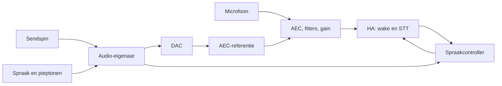

# Ontwerp: audio en spraakbesturing

Status: ontwerp voor gefaseerde implementatie, 1 november 2026.

## Uitgangspunt

Eén controller beslist over luisteren, verwerking en voorrang. Eén audio-eigenaar mengt muziek en spraak en houdt bij wat is afgespeeld. De bestaande filters, volumes, muziekverlichting en beheerde dependencies vormen de basis.

De firmware heeft al een verplichte audio-uitgang voor Assist, voorrang voor een aangevraagd vervolggesprek, één afspeelmodus per job en een afzonderlijk resultaat voor geannuleerde directe spraak. Die wijzigingen zijn gebouwd en met hosttests gecontroleerd; fysieke verificatie ontbreekt. De controller en audio-eigenaar hieronder zijn nog ontwerp.

Hardware en formaten blijven ESP32-S3 N16R8, ESP-IDF 6.0.1, PCM5102A op BCLK 6 / LRCK 5 / DOUT 7 en INMP441 op WS 8 / SCK 18 / SD 17. De DAC werkt op 48 kHz stereo, 16-bit; Assist ontvangt 16 kHz mono, 16-bit PCM.

## Spraakcontroller

De controller draait in de bestaande Assist-taak en beheert de microfoonroute, muziekdemping, afspeelopdrachten en zichtbare status. Per transactie en verbinding gebruikt hij een ID; late berichten mogen een nieuwe transactie niet wijzigen. Audio blijft in begrensde buffers, buiten de besturingsqueue.

| Toestand | Gedrag | HA-status |
| --- | --- | --- |
| Wachten op verbinding of voice ownership | Geen Assist-opname; muziek normaal | `offline` of `idle` |
| Wake bewaken | Wake-audio verzenden; muziek normaal | `idle` |
| Opname voorbereiden | Startpiep en STT voorbereiden; muziek gedempt | `starting` |
| Luisteren | Geldige samples naar STT; muziek gedempt | `listening` |
| Verwerken | Transcript controleren en opdracht verwerken; muziek normaal | `processing` |
| Spreken | Antwoord of aankondiging afspelen; muziek zachter | `speaking` |
| Herstellen | Oude verbinding en opname beëindigen; muziek normaal | `error` of `offline` |

Er is één lokale voorgrondjob: startpiep, eindpiep, antwoord, aankondiging of meettoon. Een eindpiep mag tijdens verwerking spelen. De controller handelt verlies en annulering eerst af, daarna een lopend gesprek of vervolg, vervolgens een wachtende aankondiging en ten slotte wakebewaking. Een meettoon start alleen wanneer het apparaat vrij is. De bestaande limiet van één wachtende aankondiging en 85 seconden blijft gelden.

## Opname en opdracht

Iedere commandostart via wakewoord, remote start of vervolg heeft één startpiep. Na de werkelijk afgespeelde piep en een gemeten uitklinktijd kan de gebruiker spreken. De startpiep is niet instelbaar. Spraak tijdens de piep of direct achter het wakewoord is niet gegarandeerd herkenbaar.

De huidige verse STT-run blijft behouden vanwege een eerder waargenomen vroeg einde van de opname. De wake-run eindigt bij STT en wordt na detectie ingetrokken; een verse STT-run begint zonder dat de oude run een opdracht kan uitvoeren. De vaste wake-tail van 600 ms vervalt. De bestaande 80 ms uitklinktijd is een startwaarde voor fysieke kalibratie, geen bewezen waarde.

Vanaf de geldige samplegrens worden microfoonsamples bewaard, ook als HA nog opstart. Pas als de STT-handler en die grens gereed zijn, verschijnt `listening` en worden de bewaarde samples eenmaal en in volgorde verzonden. Houd rekening met AEC-lookahead en, indien ingeschakeld, de 512 samples vertraging van de denoiser. Een ringbuffer van aanvankelijk 2 seconden vraagt 64 KB PSRAM; bij overschrijving of een gat faalt de opname zichtbaar.

RX-blokken krijgen een volgnummer en samplepositie. Ontbrekende microfoon- of transportblokken maken het hele commando ongeldig; de taak annuleert het en herstelt de filterhistorie. Ook met AEC uit moet verlies worden gedetecteerd. Een ontbrekende AEC-referentie is een kwaliteitsprobleem: bypass AEC met een expliciete status, zonder gezonde microfoonsamples als verloren te markeren.

STT eindigt vóór de intent. Lege tekst, bekende STT-artefacten en exacte stopfrasen worden lokaal afgevangen; alleen een geldig transcript start de intent-run. Een annulering kan latere verwerking stoppen, maar een al uitgevoerde HA-actie niet terugdraaien. Stilte start geen automatische nieuwe commandopoging.

## Audio-uitgang en synchronisatie

Eén `AudioRenderer` mengt Sendspin en één voorgrondbron in blokken van 240 stereoframes (5 ms). Hij speelt spraak ook als muziek tijdelijk ontbreekt. De hardwarequeue blijft aanvankelijk zes blokken (30 ms); muziek- en voorbereide uitgangsbuffers beginnen elk met twee blokken. Houd het bestaande TTS-buffer voor netwerkvariatie. Sendspin krijgt alleen het werkelijk overgenomen, frame-uitgelijnde prefix terug, binnen de toegestane schrijftijd.

Per uitgangsblok wordt bijgehouden welke frames van Sendspin en welke van een voorgrondjob afkomstig zijn. Gedempte muziek en door Sendspin aangeleverde stilte tellen als Sendspin; zelf gegenereerde stilte niet. De AEC-referentie komt van de werkelijk uitgegeven DAC-data. Een lokale aankondiging krijgt pas `done` nadat de laatste frame via DMA is voltooid. Een door HA geaccepteerde Music Assistant-fallback is alleen `HandedOff`: daadwerkelijke voltooiing is daarmee niet bewezen. Na gedeeltelijke spraak volgt geen automatische fallback.

De voorkeursbackend bereidt blokken voor in taakcontext en gebruikt de ESP-IDF-DMA-callback om een voltooid blok en zijn metadata vast te leggen en het volgende voorbereide blok of stilte te plaatsen. Kopieën en descriptorzoekwerk in de ISR blijven begrensd. De ISR doet geen DSP, allocatie, logging, netwerkwerk, NVS of Sendspin-aanroepen. Andere code schrijft niet gelijktijdig via `i2s_channel_write()`.

**Eerst bewijzen:** de gepinde Sendspin-library moet ook bij opstarten, onderloop, gemengde spraak en hardwarestilte de juiste afspeeltijd kunnen berekenen. Alleen het aantal bronframes corrigeren is daarvoor mogelijk onvoldoende. Het DMA-prototype vervangt de huidige backend pas na een integratieproef met de echte library; als de API queuegaten niet kan representeren is ondersteunde resynchronisatie of een beheerde, gepinde upstreamwijziging nodig.

Behoud de huidige gain en mute: muziek heeft de bestaande extra halvering, muziek wordt tijdens capture gedempt en tijdens lokale spraak gehalveerd; het uiteindelijke DAC-signaal wordt gehalveerd en begrensd. De meettoon behoudt zijn vaste niveau. Annulering stopt nieuwe productie; reeds ingeplande frames kunnen tot de queuegrens naklinken.

## AEC en resources

De huidige mono-AEC kan willekeurige stereo met verschillende akoestische paden niet volledig beschrijven. Stereo met mono-AEC blijft daarom experimenteel. Een optioneel monouitgangsprofiel kan een passend enkelvoudig referentiesignaal leveren, met verlies van stereobreedte. Echte stereo-AEC vereist een geschikte beheerde implementatie en afzonderlijke CPU-, RAM- en akoestische proeven.

De bestaande microfoon-, Assist- en TTS-taken blijven. Voor de renderer is één extra taak voorzien; voorlopige extra middelen zijn 64 KB PSRAM voor capture, circa 3,8 KB intern RAM voor vier audioblokken, een stack van aanvankelijk 4 KB en beperkte metadata. Hergebruik bestaande buffers waar mogelijk. De eerdere observatie van ongeveer 19 KB vrij intern RAM met AEC maakt meting van minimumheap, grootste vrije blok, stackmarges en CPU-belasting onder TLS, TTS en diagnostiek noodzakelijk. ISR-data blijft in intern RAM.

Start de audioresources en controller voordat netwerkverzoeken jobs kunnen starten. Kritieke fouten en annuleringen mogen bij een volle eventqueue niet verloren gaan. Telemetrie en HomeDash zijn begrensde nevenactiviteiten.

## Uitvoering en acceptatie

1. **Controller en prioriteiten:** voer één toestand en expliciete job-/transactie-ID's in. Test oude events, annulering, een vervolg met wachtende aankondiging en foutafhandeling.
2. **Capture en STT:** voer samplegrenzen, verliesdetectie en STT-vóór-intent in. Test één startpiep per commandostart, bewaarde aanloop, gaten, stopfrasen en artefacten. Controleer wake/VAD en de uitklinktijd fysiek.
3. **DMA-prototype:** toets bronadministratie en de echte Sendspin-tijdrekening bij startup en onderloop. Meet ISR-tijd, CPU en intern RAM vóór overstap.
4. **Audio-eigenaar:** leid muziek, spraak, pieptonen en meettoon via de renderer. Test gedeeltelijke writes, muziekonderloop, annulering en de laatste afgespeelde frames.
5. **AEC-profiel:** vergelijk stereo en optioneel mono met onafhankelijke kanalen, tegenfase en ongelijke akoestische paden. Meet herkenning op het apparaat.

Elke firmwarestap krijgt betekenisvolle hosttests, een vermelding in `CHANGES.md` en een build via `./scripts/idf.sh build`. Wijzig `managed_components` niet; dependencies blijven beheerd en gepind. Een build bewijst geen fysieke werking.

Voor fysieke acceptatie: minimaal 20 wake-/commandopogingen per afgesproken combinatie van muziek uit/aan, eindpiep uit/aan en normaal/verhoogd speakerniveau. Leg eerste-pogingsucces, ontbrekende beginwoorden, valse starts en latency vast. Observeer daarnaast minimaal 30 minuten stilte/muziek en vergelijk muziektiming met een tweede Sendspin-speler of meetreferentie.

Contracten: [Home Assistant Assist-pipelines](https://contributors.home-assistant.io/core/internals/assist-pipelines/) en [ESP-IDF 6.0.1 I2S](https://docs.espressif.com/projects/esp-idf/en/v6.0.1/esp32s3/api-reference/peripherals/i2s.html). Test de werkelijk geïnstalleerde HA-versie en de timing op hardware.
